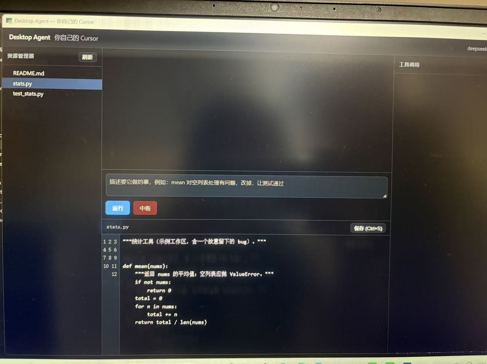
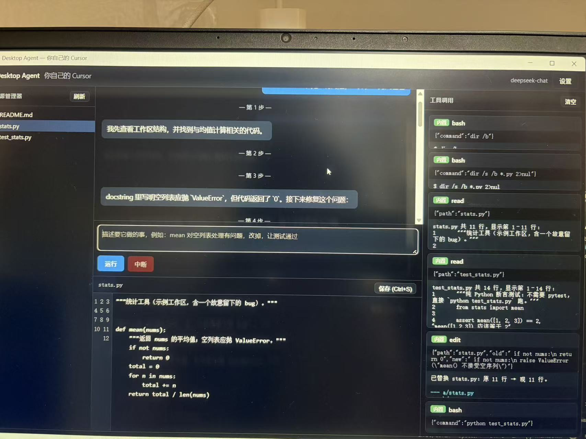
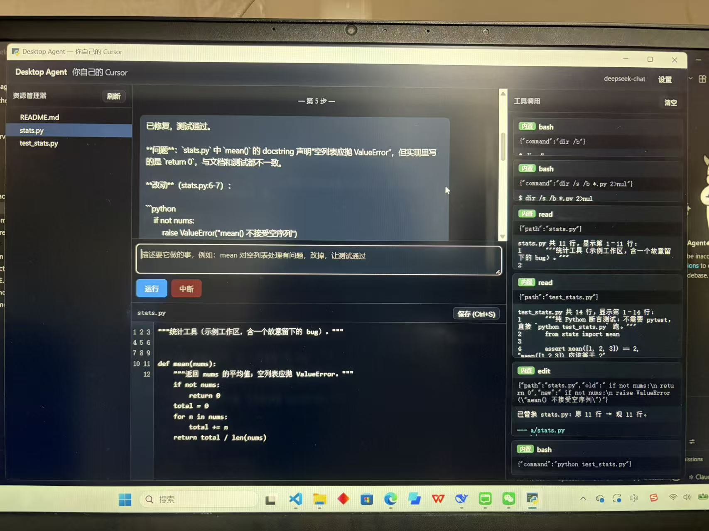

# Desktop Agent —— 你自己的 Cursor

一个能**双击打开**的桌面智能体：接大模型、四个工具（read / write / edit / bash）、可接 MCP。
对应课程《Python 编程与案例实务 · 智能体专题》大作业。

## 三步启动

```bash
# 1. 装依赖
pip install -r requirements.txt

# 2. 配 Key（复制 .env.example 为 .env，填入 LLM_API_KEY）
#    也可以先跳过，启动后在界面右上角「设置」里填

# 3. 启动（出原生窗口，不是浏览器）
python main.py
```

> 只用后端（不要窗口）：`uvicorn server.app:app --port 8123`
> 然后 `curl -N "http://127.0.0.1:8123/api/stream?task=..."` 就能看到事件流。

### 还没 Key？先验证核心逻辑

```bash
python tests/test_tools.py   # 四个工具的语义测试（10 项）
python tests/test_loop.py    # 循环与护栏测试（4 项）
python scripts/gen_trace.py  # 生成 docs/trace.md（脚本化模型，真实跑工具）
```

## 三个界面






## 目录结构

```
desktop-agent/
├── main.py              # 桌面入口：后台起 FastAPI + pywebview 开窗口
├── agent/               # 循环 + 四个工具 + 模型 + MCP（能脱离界面单独跑）
│   ├── loop.py          #   ReAct 循环 + 护栏 + 事件流
│   ├── tools.py         #   read / write / edit / bash
│   ├── llm.py           #   OpenAI 兼容客户端 + 脚本化假模型
│   └── mcp.py           #   stdio MCP 客户端（纯标准库）
├── server/app.py        # FastAPI：REST + SSE + WebSocket
├── ui/                  # index.html / app.js / style.css（三栏界面）
├── mcp.json             # MCP server 配置
├── mcp_servers/         # 示例 MCP server（weather）
├── workspace/           # 默认工作目录（含一个带 bug 的 stats.py）
├── tests/               # 工具与循环测试
└── docs/                # trace.md / build.md / 截图
```

## 现场演示备忘

- 需求示例：「mean 对空列表处理有问题，改掉，让测试通过」
- 演示「失败与恢复」：让它撞上 `edit` 不唯一（改一段出现两次的代码），看它报错后补充上下文。
- MCP：问「杭州今天天气怎么样」会走 `get_weather`（MCP 工具在日志里标紫色 MCP 标签）。

## 评分自查

- [x] 四个工具语义正确（read 行号/分页、write 原子写、edit 唯一性、bash 超时）
- [x] 工具调用可见、可中断
- [x] MCP 真接上（stdio JSON-RPC）
- [x] trace 真实（`docs/trace.md`，含失败→恢复）
- [ ] public 仓库 + ≥15 commit + ≥7 天跨度
- [ ] Release 里有一个能装的安装包（见 `docs/build.md`）
